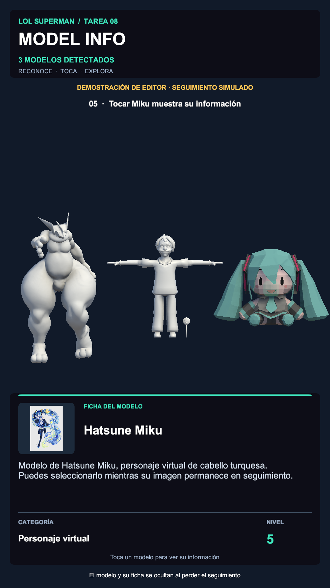

# LOL SUPERMAN — Tarea 08: Model Info

Proyecto de Unity **6000.3.14f1** con reconocimiento de imágenes mediante **AR Foundation / ARCore 6.3.5**.

Abrir esta carpeta raíz en Unity y cargar **`Assets/Scenes/Tarea 08.unity`**.

La escena reconoce Greninja, Paletas y Miku, instancia su modelo y permite seleccionarlo con un toque. El panel muestra nombre, descripción, categoría, nivel e icono desde un ScriptableObject por imagen. Al perder el seguimiento, el modelo desaparece y la ficha seleccionada vuelve al estado original.

Consultar **[TAREA-08.md](TAREA-08.md)** para la implementación, las comprobaciones, los pasos para generar el APK y los entregables.

[APK Android](Entrega/Tarea08/Tarea08-ModelInfo.apk) · [Video de editor con seguimiento simulado](Entrega/Tarea08/Tarea08-Demostracion-Editor.mp4) · [33 comprobaciones](Entrega/Tarea08/verificacion.json)

Este proyecto se encuentra en la subcarpeta `LOL SUPERMAN/` del repositorio [shinjekyag/Tarea-2](https://github.com/shinjekyag/Tarea-2). En Unity Hub, selecciona esta carpeta, que contiene `Assets`, `Packages` y `ProjectSettings`.
